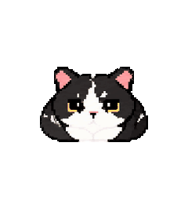

# Chunxi Desktop Pet

A quiet, relaxed pixel-art tuxedo cat that keeps you company while you work. Built with Python and PySide6 for Windows; no ChatGPT/Codex host or network service is required.

**[v0.1.1 is available](https://github.com/WilliamZXT/Chunxi-Desktop-Pet/releases/tag/v0.1.1).** [中文](README.md)

## Meet Chunxi

| Sitting · blinking · ear movement | Loaf | Dozing |
| :---: | :---: | :---: |
|  |  |  |

These looping GIFs preview existing animation assets used by the desktop pet; they are not a real-time recording of autonomous behavior. Preview speed does not represent actual action frequency. In the app, blinks and ear twitches occur at randomized intervals, with loafing and dozing after inactivity. No character artwork or animation was recreated.

## Download and run

Open the **[v0.1.1 Release](https://github.com/WilliamZXT/Chunxi-Desktop-Pet/releases/tag/v0.1.1)**, download **[ChunxiDesktopPet-v0.1.1-win-x64.zip](https://github.com/WilliamZXT/Chunxi-Desktop-Pet/releases/download/v0.1.1/ChunxiDesktopPet-v0.1.1-win-x64.zip)**, and verify it using the accompanying **[SHA256SUMS.txt](https://github.com/WilliamZXT/Chunxi-Desktop-Pet/releases/download/v0.1.1/SHA256SUMS.txt)**. The Windows x64 package includes the runtime dependencies.

1. Extract the entire ZIP and retain _internal/ next to the EXE.
2. Exit the older pet, then run ChunxiDesktopPet.exe.
3. Existing AppData preferences are preserved. Personal configurations are excluded from both repository and downloads. New users receive factory defaults and may adjust settings from the context menu.
4. No Python installation or administrator access is required.

## Features and controls

- Transparent, borderless, optionally always-on-top window; drag to move without also triggering clicks.
- Gentle breathing, random blinks and ear twitches; loaf and doze after inactivity, then wake slowly on input.
- Occasional cursor observation and probabilistic click feedback with independent cooldowns. Repeated feedback may be skipped.
- Right-click the cat or tray icon. **调节大小…** previews 50%–300% size; Save remembers it, Cancel restores size and position.
- **设置…** controls size, topmost, frequency and optional login startup, disabled by default.
- **暂停自动行为** pauses scheduling; **恢复自动行为（当前已暂停）** resumes it. Current animation can continue while scheduling is paused.
- **退出春喜** exits. **回到屏幕右下方** restores a visible position.

## Factory defaults

Blink: 12–28 seconds; ear twitch: 65–145 seconds. Loaf after 50–95 seconds and doze after 210–330 seconds of inactivity. Observation: 22% probability with 45–100 second cooldown. Click: 40% candidate probability with 30–70 second cooldown; repeated feedback may be skipped. Valid user preferences override defaults and are not distributed.

## Run from source

Use Windows x64 Python 3.12. From `desktop/`:

```powershell
py -3.12 -m venv .venv
.\.venv\Scripts\python.exe -m pip install -r requirements.txt
.\.venv\Scripts\python.exe .\run.py
```

Alternatively use `Start-Chunxi.cmd` once the environment exists. Recreate the virtual environment after relocating source.

```powershell
.\.venv\Scripts\python.exe -m pip install -r requirements-build.txt
.\build\build.ps1
```

Output: `desktop/build/dist/v0.1.1/ChunxiDesktopPet/`. Distribute the entire folder. Dependencies are pinned: PySide6 6.10.0, PyInstaller 6.16.0 and hooks 2026.9. Build PATH isolation prevents unrelated native dependencies from being collected.

## Layout and limitations

`lite/` preserves the host pet snapshot; `desktop/src/chunxi/` separates window, animation, state machine, interaction, configuration, settings, startup and display logic. `desktop/assets/`, `desktop/config/`, `desktop/tests/`, `desktop/build/`, `shared/sprites/` and `docs/` contain the required resources and instructions.

Existing evidence includes 46 automated tests and real Windows EXE lifecycle, recovery, duplicate-instance and current mixed-DPI display checks. This publication pass adds no tests and does not claim to have rerun them. See [check summary](docs/TEST-REPORT.md).

The EXE is unsigned. SmartScreen or unknown-publisher warnings remain possible. This binary has no new two-hour endurance or Defender scan result, clean-machine acceptance, physical hotplug, sleep/resume, Remote Desktop or actual login-startup acceptance. Pose transitions are discrete; fractional scaling can produce uneven pixel steps. See [known limitations](docs/KNOWN-ISSUES.md).

No AI conversation, voice or advanced physics is included. Input monitoring reads timestamps and cursor position, not typed content.

## License and permitted use

Application source code, tests, and build/startup scripts use the [MIT License](LICENSE-CODE-MIT.txt), Copyright (c) 2026 WilliamZXT.

Chunxi character designs, pixel artwork, animation frames, icons, and other artwork are excluded from MIT; artwork copyright is reserved. Users may download, install, and use the official desktop-pet application. Without permission, artwork must not be separately extracted, reposted, modified, or used in other commercial products. No CC BY-NC or other artwork license is added. Third-party components retain their own terms; notices are included in THIRD-PARTY-NOTICES/.
